# Hi, I'm Nayan Mishra 👋

**Computer Science / Artificial Intelligence / Systems**

*AN EXPERIMENT IN CODE, MOTION, AND IMAGINATION.*

Exploring intelligent systems, machine learning, software engineering, and the boundaries between research and building.

## Now

- 🔭 Currently working on: Finias, and some research
- 🌱 Currently learning: machine learning and LLMs
- 👯 Looking to collaborate on: open source projects

## About

- 🏢 Founder at **Phinneas** — private app distribution for AI-built apps
- 🌐 [phinneas.me/founder](https://phinneas.me/founder) — founder notes
- 🛠️ Currently deep in: Next.js + TypeScript + Supabase, GitHub Actions build machines, Tauri/Electron/Capacitor release pipelines, MCP deploy tooling

## 01 / RESEARCH

Artificial Intelligence
Machine Learning
Computer Systems
Human-Computer Interaction

## 02 / PROJECTS

| Project | What it is |
| --- | --- |
| [Velune AI](https://github.com/nayan-mis/velune-ai) | AI-assisted skincare and ingredient education. |
| [Repositories](https://github.com/nayan-mis/nayan-mis) | Software experiments, prototypes and engineering. |
| [INKBOUND](https://github.com/nayan-mis/inkbound) | Procedural animation and cinematic rendering. |

## 03 / ENGINEERING

**LANGUAGES** — Python / TypeScript

**APPLICATIONS** — Web / APIs / Interactive Systems

**AI** — Machine Learning / Agents / Evaluation

## 04 / PRINCIPLES

**Understand the fundamentals.** — Build from first principles.

**Experiment deliberately.** — Turn ideas into testable systems.

**Design with intent.** — Care about behaviour and reliability.

## 05 / CONNECT

**GITHUB.COM/NAYAN-MIS**

**INKBOUND / 2026**
