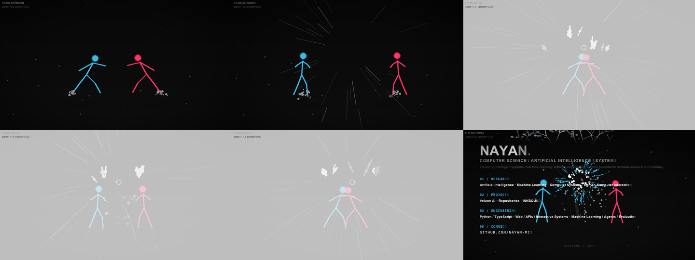

<p align="center">
  <a href="https://nayan-mis.github.io/nayan-mis/README.html">
    
  </a>
</p>

<p align="center">
  <a href="https://nayan-mis.github.io/nayan-mis/README.html">▶ Watch in the player</a>
  &nbsp;·&nbsp;
  <a href="https://github.com/nayan-mis/nayan-mis/blob/main/README.html">Source of the film</a>
</p>

<h1 align="center">Nayan Mishra</h1>

<p align="center">
  <b>Computer Science · Artificial Intelligence · Systems</b><br>
  <sub>I build things that are useful, and sometimes things that are only beautiful.</sub>
</p>

---

## Now

- Building **[Phinneas](https://github.com/nayan-mis/phinneas)** — private distribution for AI-built apps.
- Rendering **INKBOUND** — a deterministic 12-second film generated frame by frame in Python. No editor, no keyframes, no GPU.
- Learning how language models reason, and how to measure whether they actually do.

## INKBOUND

Five acts in twelve seconds: two fighters meet, ink breaks, a tree grows out of the collision. Every frame is computed from a seeded timeline, so frame 180 is always frame 180 — run it twice, get the same film.

| | |
| --- | --- |
| **Renderer** | Python + Pillow, nine modules, 960 × 540 at 20 fps |
| **Systems** | choreography · particles · procedural tree · typography · effects · camera · export |
| **Formats** | PNG sequence → MP4, WebP, GIF |
| **Player** | [nayan-mis.github.io/nayan-mis/README.html](https://nayan-mis.github.io/nayan-mis/README.html) |

```bash
pip install -r requirements.txt
python -m src.render --test                 # verify the renderer
python -m src.render --frame 160            # one frame
python -m src.render --png --draft          # full sequence
python -m src.render --export               # animated WebP
```

<p align="center">
  
</p>

## Selected work

- **[Phinneas](https://github.com/nayan-mis/phinneas)** — private app distribution for AI-built apps. TypeScript, release pipelines, build machines.
- **[Velune AI](https://github.com/nayan-mis/velune-ai)** — AI-assisted skincare and ingredient education.
- **[crawlbouncer](https://github.com/nayan-mis/crawlbouncer)** — keeps crawlers out, lets people in. Python.
- **[mailsort](https://github.com/nayan-mis/mailsort)** — sorts Gmail and Yahoo inboxes in the browser. No server, no account.
- **[void](https://github.com/nayan-mis/void)** — an experiment in negative space.

## Tools

`Python` `TypeScript` `Next.js` `Supabase` `Pillow` `NumPy` `Tauri` `Electron` `Capacitor` `GitHub Actions`

## Principles

**Understand the fundamentals.** Build from first principles, not from the last tutorial.

**Experiment deliberately.** Turn ideas into systems you can test and measure.

**Design with intent.** Behaviour and reliability are part of the interface.

## Connect

[phinneas.me/founder](https://phinneas.me/founder) &nbsp;·&nbsp; [github.com/nayan-mis](https://github.com/nayan-mis) &nbsp;·&nbsp; [nayan-mis.github.io](https://nayan-mis.github.io/nayan-mis/README.html)

<sub>INKBOUND / 2026 — rendered, not drawn.</sub>
